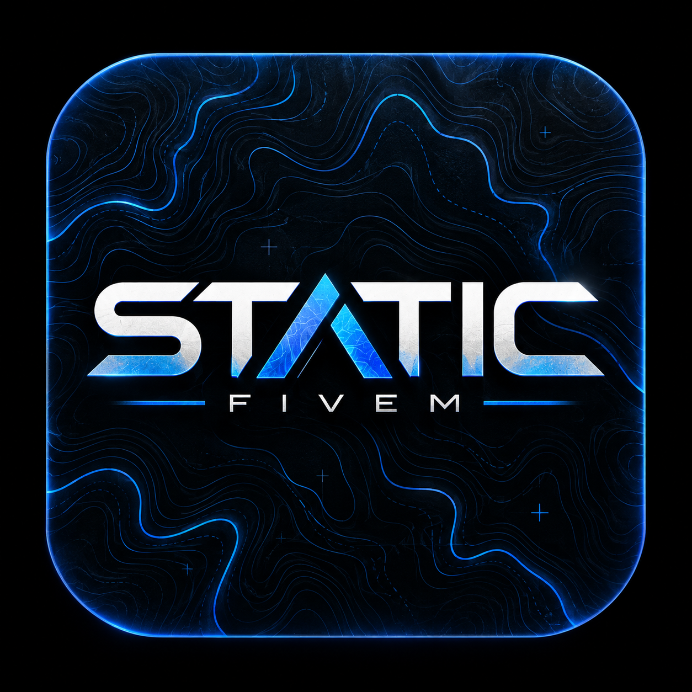
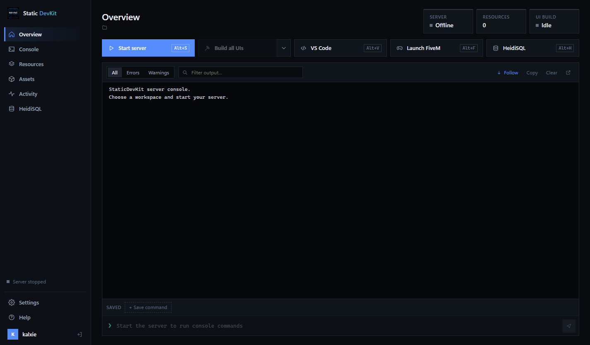
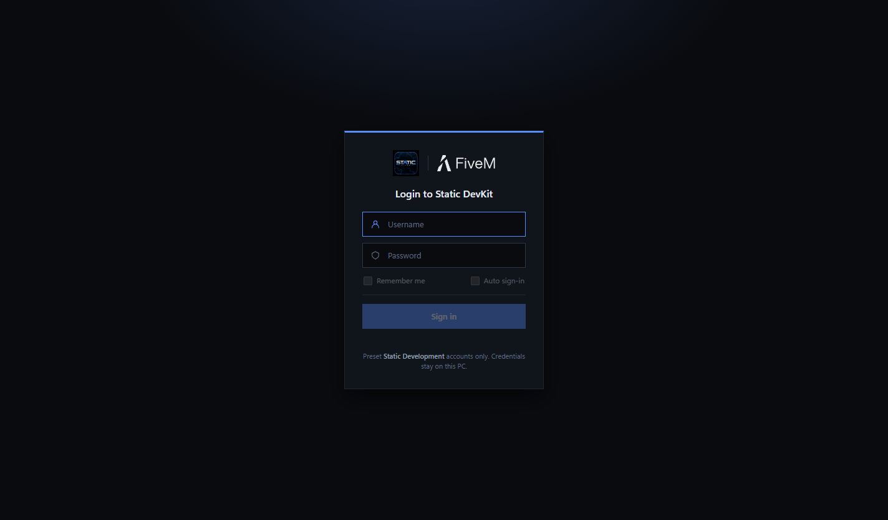
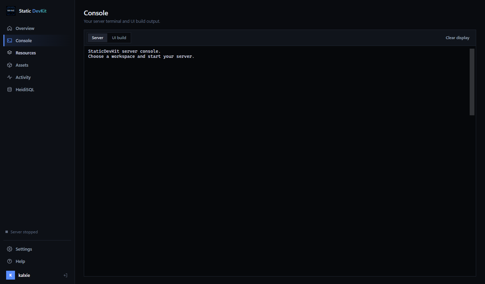
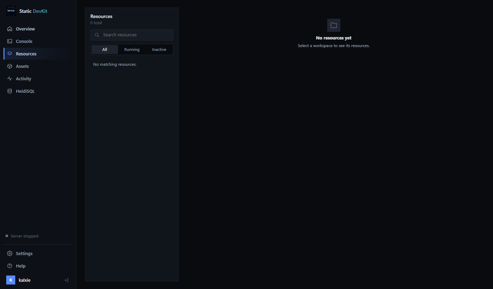

<p align="center">
  
</p>

<h1 align="center">StaticDevKit</h1>

<p align="center">
  <b>A desktop control centre for FiveM server development.</b><br />
  Run your FXServer, watch its console, profile resources, edit code and manage your database — all from one window.
</p>

<p align="center">
  
  
  
</p>

<p align="center">
  <a href="https://github.com/Kalxie/StaticDevKit/releases/latest/download/StaticDevKit-Setup.exe">
    
  </a>
</p>

<p align="center">
  
</p>

---

## What is it?

**StaticDevKit** is a Windows desktop app by **Static Development** that brings the everyday tools of FiveM development together. Instead of juggling a terminal running FXServer, a HeidiSQL window, VS Code and the FiveM client, you point the kit at your `server-data` folder and drive everything from one place.

## Features

- 🖥️ **Server control** — start, stop and restart FXServer from a real embedded terminal
- 📜 **Live console** — filter output by errors and warnings, save commands you use often
- 📦 **Resources** — browse every resource in your workspace and jump straight into the code
- 📈 **Resmon** — per-resource and per-thread timings from FXServer's profiler
- 🗄️ **HeidiSQL, docked** — your database tool runs inside its own tab
- ✏️ **VS Code** — open a resource or a file at a specific line in one click
- 🎮 **Launch FiveM** — connect your local client to the dev server instantly
- 🔍 **Auto-discovery** — finds FiveM, HeidiSQL and VS Code on your machine
- ⌨️ **Keyboard shortcuts** — `Alt+S` server, `Alt+V` VS Code, `Alt+F` FiveM, `Alt+H` HeidiSQL

## Screenshots

<table>
  <tr>
    <td align="center"><br /><sub><b>Secure sign-in</b></sub></td>
    <td align="center"><br /><sub><b>Overview</b></sub></td>
  </tr>
  <tr>
    <td align="center"><br /><sub><b>Server console</b></sub></td>
    <td align="center"><br /><sub><b>Resource browser</b></sub></td>
  </tr>
</table>

## Installation

1. **[Download `StaticDevKit-Setup.exe`](https://github.com/Kalxie/StaticDevKit/releases/latest/download/StaticDevKit-Setup.exe)**
2. Run the installer. Windows SmartScreen may warn that the app is unrecognised because it isn't code-signed yet — choose **More info → Run anyway**.
3. Sign in, pick your `server-data` folder (see [Setting up your server folder](#setting-up-your-server-folder)), and you're set.

To update, download the latest installer and run it over your existing install.

## Setting up your server folder

StaticDevKit works with the standard FXServer layout. When it asks for a workspace, choose your **`server-data`** folder: the one that contains `server.cfg`.

```
FXServer/
├── server/                     ← FXServer artifacts (download from runtime.fivem.net)
│   ├── FXServer.exe
│   └── ...
└── server-data/                ← choose this folder in StaticDevKit
    ├── server.cfg              ← required: server settings, license key, ensures
    ├── builder.bat             ← optional: custom start script (used instead of FXServer.exe)
    └── resources/              ← required: all your resources live here
        ├── build-react-uis.ps1 ← optional: script for the "Build all UIs" button
        ├── [core]/             ← [bracketed] folders are categories, not resources
        │   ├── my_framework/
        │   │   ├── fxmanifest.lua
        │   │   ├── client.lua
        │   │   └── server.lua
        │   └── my_inventory/
        ├── [maps]/
        │   └── my_mlo/
        │       ├── fxmanifest.lua
        │       └── stream/     ← .ydr, .ytd, .ymap… files appear in the Assets tab
        └── my_script/
            └── fxmanifest.lua
```

**What StaticDevKit looks for**

| Path | Required | Used for |
|---|---|---|
| `server-data/server.cfg` | ✅ | Identifies the folder as a server; FXServer starts with `+exec server.cfg` |
| `server-data/resources/` | ✅ | Every resource shown in the Resources tab |
| `../server/FXServer.exe` | One of these two | Starts the server when there's no `builder.bat` |
| `server-data/builder.bat` | One of these two | A custom start script, run in place of FXServer.exe |
| `resources/<name>/fxmanifest.lua` | ✅ per resource | Marks a folder as a resource and lists its dependencies (`__resource.lua` also works) |
| `resources/<name>/stream/` | Optional | Streamed assets listed in the Assets tab |
| `resources/build-*-uis.ps1` | Optional | PowerShell script run by the **Build all UIs** button |

**Tips**

- Group resources in `[category]` folders. They help you organise and don't change resource names, so `ensure my_framework` still works.
- Keep `server/` and `server-data/` side by side so StaticDevKit can find `FXServer.exe` on its own.
- Every resource needs a manifest. A minimal one looks like this:

  ```lua
  fx_version 'cerulean'
  game 'gta5'

  client_script 'client.lua'
  server_script 'server.lua'
  ```

- Start resources from `server.cfg` with `ensure`, and list dependencies before the resources that use them:

  ```cfg
  ensure my_framework
  ensure my_inventory
  ensure [maps]        # ensures every resource in the category
  ```

New to FXServer? Follow the official [server setup guide](https://docs.fivem.net/docs/server-manual/setting-up-a-server-vanilla/) first, then point StaticDevKit at the `server-data` folder it creates.

## Is it safe?

Yes. StaticDevKit is a local developer tool: it launches programs you already have (FXServer, FiveM, HeidiSQL, VS Code) and reads your `server-data` folder. It doesn't collect telemetry, and your sign-in details are stored only on your PC.

Because the installer isn't code-signed yet, Windows and some antivirus tools may flag it as "unrecognised". You can check it yourself:

- **VirusTotal scan:** [view the report](https://www.virustotal.com/gui/file/d9e51f99b75cbfde9313165d725ce79af878d6ce154ed174cab69671fed541e5), which checks the file against 70+ antivirus engines.
- **Checksum:** confirm your download matches the official build. In PowerShell:

  ```powershell
  Get-FileHash .\StaticDevKit-Setup.exe -Algorithm SHA256
  ```

  The hash for each version is listed in its [release notes](https://github.com/Kalxie/StaticDevKit/releases).

## Requirements

- Windows 10 or 11 (64-bit)
- An FXServer `server-data` folder
- Optional: [FiveM](https://fivem.net/), [HeidiSQL](https://www.heidisql.com/), [VS Code](https://code.visualstudio.com/)

## License

© Static Development. All rights reserved.
